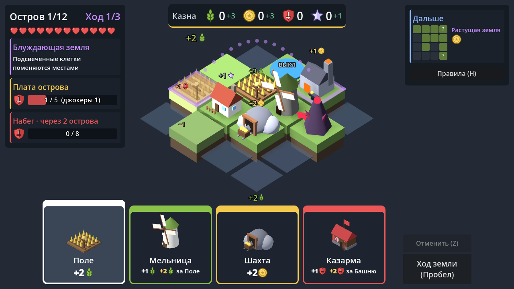

# TinyBuilder

Карточный градостроительный пазл-рогалик. Сейчас при запуске открывается второй прототип — **«Живая земля»**. Первый прототип (поле 3×3) остался в проекте: сцена `scenes/main.tscn`.



## Как запустить

1. Скачайте [Godot 4.7 или новее](https://godotengine.org/download) (обычная версия, не .NET).
2. Запустите Godot, нажмите **Import** и выберите файл `project.godot` из этой папки.
3. Нажмите **F5** (или ▶ в правом верхнем углу).

## Живая земля: как играть

- Поле — кусок земли из 8–10 клеток внутри рамки 4×4, форма каждый раз своя. На поле бывают камни, озёра, готовые постройки и местность (+1 или −1 зданию).
- На поле 3 хода. В руке 4 карты, за ход можно поставить до 2. Потом нажимаете **Ход земли** (Пробел), и ходит земля. Рука добирается до 4.
- **У каждого поля один характер земли**, и он срабатывает после каждого вашего хода. Что земля сделает, видно заранее (подсвеченные клетки):
  - *Блуждающая земля* — две клетки меняются местами вместе с постройками;
  - *Трещины* — постройки на подсвеченных клетках рушатся;
  - *Растущая земля* — к полю прирастает клетка;
  - *Обрыв* — клетка на краю обрушивается вместе с постройкой;
  - *Логова* — появляется Логово, которое выключает одно здание по стрелке (кроме Казармы и Башни). Казарма или Башня рядом сносит Логово.
- **Казна на весь забег.** Весь доход островов копится в казне (крупно сверху). В конце острова из неё платится **плата острова** (3–7 ресурсов), на 3, 6 и 9 островах приходят **боссы**, в конце 12-го — **финальная угроза** (6 каждого цвета). Каждая недостающая единица — −1 жизнь (на финале −2).
- Выполнили плату острова раньше — жмите **Забрать остров** (Enter): земля больше не ходит, но и дохода в казну будет меньше.
- Карты:
  - *Добыча* (Поле, Шахта, Башня): +2 своего цвета.
  - *Мастерская* (Мельница, Кузница, Казарма): +1, и ещё +2 за каждую соседнюю добычу своего цвета.
  - *Жильё* (Домик +1, Усадьба +2): джокеры — закрывают нехватку любого цвета.
  - *Рынок*: +1 за каждый цвет среди соседей. *Таверна*: +1 жизнь за каждое соседнее жильё.
- Добыча и мастерские **разных цветов** рядом — недовольство: в конце острова −1 жизнь за каждую такую сторону. Жильё и городские ни с кем не ссорятся.
- После поля выбираете карту в колоду или отдых (+1 жизнь). Следующее поле видно заранее: форма, «?» на месте препятствий, характер земли и нужные ресурсы (без чисел).
- Пройдите 12 островов, чтобы победить. Жизней 12.
- Наведите на здание — увидите, из чего сложился его доход. С выбранной картой над клеткой видно, сколько она даст и будет ли недовольство.
- **1–4** — выбрать карту, **ПКМ/Esc** — снять выбор, **Z** — отменить постройку в этом ходу, **Пробел** — ход земли.

Модели зданий собраны из простых фигур Godot в `scripts/view/models.gd` (сторонних ассетов нет). Картинки на картах — это те же модели, отрендеренные в маленьком окне, так что карта и остров всегда совпадают.

## Баланс живой земли без кода

- `data/land/cards.json` — здания, препятствия, местность, стартовая колода.
- `data/land/run.json` — жизни, размер руки, число ходов, правила дохода (`rules`), генерация полей, события земли (частота, с какого поля), задания полей, глобальные угрозы, награды.

Проверка баланса ботом: `godot --headless --path . -s tests/land_simulate.gd -- 300` (жадный бот, который видит намерение земли, против случайного).

---

# Первый прототип: поле 3×3

Чтобы запустить его, откройте в Godot сцену `scenes/main.tscn` и нажмите **F6** (запустить текущую сцену).


## Как играть

- Внизу рука из 3–5 случайных карт из вашей колоды. Кликните карту (или нажмите 1–5), потом клетку поля.
- На карте написано, с какими зданиями она даёт комбо (цветной квадратик — цвет здания-партнёра).
- Когда карта выбрана, на свободных клетках видно, сколько поле получит. Золотые клетки — там сработает комбо. При наведении золотые дорожки показывают, с кем именно.
- После постройки вылетают числа, а сработавшие комбо вспыхивают. Здания с активным комбо соединены золотой дорожкой.
- Над каждым зданием подписан его доход. Наведите на здание, чтобы увидеть, какие комбо сработали.
- Справа — книга комбо: найденные комбинации открываются и сохраняются между забегами (файл `combo_book.json` в папке данных Godot, `user://`; удалите его, чтобы начать книгу заново).
- Серые камни — занятые клетки. Иногда на поле уже стоят здания: они тоже участвуют в комбо.
- Поля случайные, но с проверкой: генератор перебирает все раскладки вашей руки и даёт только выполнимое задание. Камень не ставится в центр, всегда есть пара свободных соседних клеток. Чем дальше, тем ближе цель задания к максимуму. После поля видно, какой был максимум.
- **Z** — отменить ход на этом поле, **Пробел** — завершить поле, **ПКМ/Esc** — снять выбор карты.
- Ресурсы дают только комбо: здание без соседей-партнёров приносит 0. Базовый доход можно вернуть в `data/cards.json` (поле `yield`).
- Доход поля уходит в запасы. Если выполнено задание поля, вы получаете награду.
- После каждого поля выбираете путь: «Спокойные земли» (задание проще) или «Дикие земли» (больше камней, задание сложнее, награда ×2 и новая карта). Рука на следующее поле видна заранее.
- В блоке угрозы видно, сколько в среднем нужно набирать за поле и успеваете ли вы при текущем темпе.
- Каждые 4 поля приходит угроза: нужно иметь в запасах нужные ресурсы, они тратятся. После отбитой угрозы выбираете новую карту в колоду. Не хватило — забег окончен. Отбейте все 5 угроз, чтобы победить.

## Как менять баланс без кода

Все цифры лежат в `data/` в JSON-файлах, их можно править в любом текстовом редакторе:

- `data/cards.json` — здания (доход, цвет, форма) и стартовая колода.
- `data/combos.json` — комбо соседства. Пример: `{ "building": "house", "neighbor": "field", "min": 1, "bonus": { "food": 3 } }` значит «домик рядом хотя бы с одним полем даёт +3 еды». `"per": true` даёт бонус за каждого соседа.
- `data/run.json` — размер руки, сколько камней и готовых зданий на поле, задания и их сложность (`generation`), угрозы, награды.

Если в JSON ошибка, Godot напишет её в панели Output внизу редактора.

## Для разработки

```
godot --headless --path . -s tests/run_tests.gd        # тесты правил
godot --headless --path . -s tests/simulate.gd -- 500  # баланс: забеги ботом, который перебором находит лучшую расстановку
godot --headless --path . -s tests/land_tests.gd       # тесты живой земли
godot --headless --path . -s tests/land_simulate.gd -- 300
```

Код:
- `scripts/land/` — правила живой земли: поле 4×4 и доход (`land_field.gd`), генерация полей (`land_gen.gd`), события земли (`land_events.gd`), забег (`land_run.gd`), бот (`land_bot.gd`).
- `scripts/view/land_main.gd` — сцена живой земли.
- `scripts/core/` — правила без графики: данные, поле, колода, забег.
- `scripts/view/main.gd` — 3D-сцена (ортокамера, кубики-плейсхолдеры) и интерфейс.
