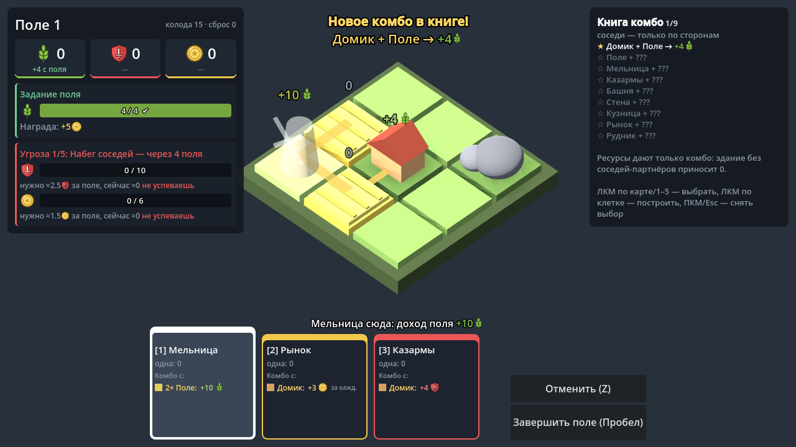

# TinyBuilder

Карточный градостроительный пазл-рогалик. Сейчас это первый прототип: проверяем, интересен ли сам пазл на поле 3×3.



## Как запустить

1. Скачайте [Godot 4.4 или новее](https://godotengine.org/download) (обычная версия, не .NET).
2. Запустите Godot, нажмите **Import** и выберите файл `project.godot` из этой папки.
3. Нажмите **F5** (или ▶ в правом верхнем углу).

## Как играть

- Внизу рука из 3–5 случайных карт из вашей колоды. Кликните карту (или нажмите 1–5), потом клетку поля.
- На карте написано, с какими зданиями она даёт комбо (цветной квадратик — цвет здания-партнёра).
- Когда карта выбрана, на свободных клетках видно, сколько поле получит. Золотые клетки — там сработает комбо. При наведении золотые дорожки показывают, с кем именно.
- После постройки вылетают числа, а сработавшие комбо вспыхивают. Здания с активным комбо соединены золотой дорожкой.
- Над каждым зданием подписан его доход. Наведите на здание, чтобы увидеть, какие комбо сработали.
- Справа — книга комбо: найденные комбинации открываются и сохраняются между забегами (файл `combo_book.json` в папке данных Godot, `user://`; удалите его, чтобы начать книгу заново).
- Серые камни — занятые клетки. Иногда на поле уже стоят здания: они тоже участвуют в комбо.
- Поля случайные, но с проверкой: генератор перебирает все раскладки вашей руки и даёт только выполнимое задание. Камень не ставится в центр, всегда есть пара свободных соседних клеток. Чем дальше, тем ближе цель задания к максимуму. После поля видно, какой был максимум.
- **Z** — отменить ход на этом поле, **Пробел** — завершить поле, **ПКМ/Esc** — снять выбор карты.
- Ресурсы дают только комбо: здание без соседей-партнёров приносит 0. Базовый доход можно вернуть в `data/cards.json` (поле `yield`).
- Доход поля уходит в запасы. Если выполнено задание поля, вы получаете награду.
- После каждого поля выбираете путь: «Спокойные земли» (задание проще) или «Дикие земли» (больше камней, задание сложнее, награда ×2 и новая карта). Рука на следующее поле видна заранее.
- В блоке угрозы видно, сколько в среднем нужно набирать за поле и успеваете ли вы при текущем темпе.
- Каждые 4 поля приходит угроза: нужно иметь в запасах нужные ресурсы, они тратятся. После отбитой угрозы выбираете новую карту в колоду. Не хватило — забег окончен. Отбейте все 5 угроз, чтобы победить.

## Как менять баланс без кода

Все цифры лежат в `data/` в JSON-файлах, их можно править в любом текстовом редакторе:

- `data/cards.json` — здания (доход, цвет, форма) и стартовая колода.
- `data/combos.json` — комбо соседства. Пример: `{ "building": "house", "neighbor": "field", "min": 1, "bonus": { "food": 3 } }` значит «домик рядом хотя бы с одним полем даёт +3 еды». `"per": true` даёт бонус за каждого соседа.
- `data/run.json` — размер руки, сколько камней и готовых зданий на поле, задания и их сложность (`generation`), угрозы, награды.

Если в JSON ошибка, Godot напишет её в панели Output внизу редактора.

## Для разработки

```
godot --headless --path . -s tests/run_tests.gd        # тесты правил
godot --headless --path . -s tests/simulate.gd -- 500  # баланс: забеги ботом, который перебором находит лучшую расстановку
```

Код:
- `scripts/core/` — правила без графики: данные, поле, колода, забег.
- `scripts/view/main.gd` — 3D-сцена (ортокамера, кубики-плейсхолдеры) и интерфейс.
